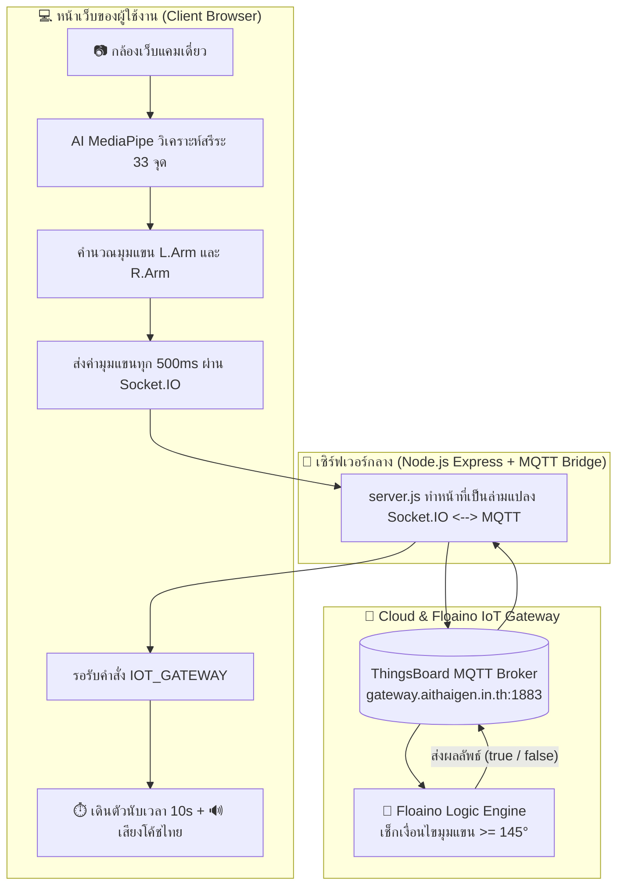
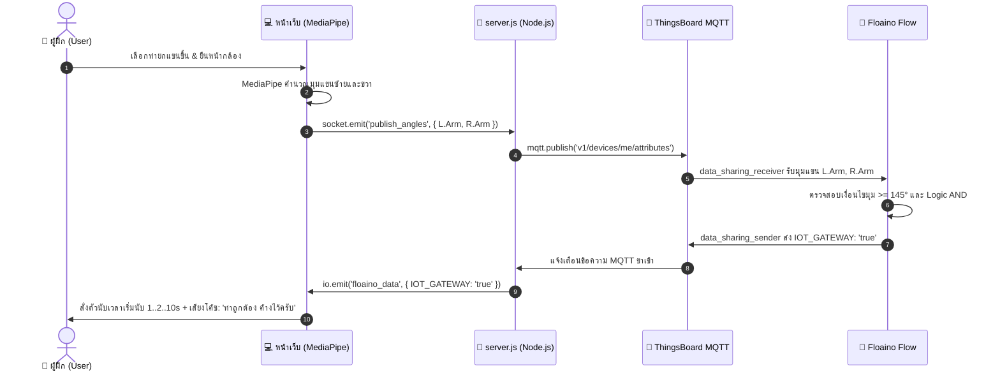

# 🧘‍♂️ ระบบวิเคราะห์และโค้ชท่าทางฤๅษีดัดตนอัจฉริยะ (Ruesi Posture AI Coach)
### ผสานพลังปัญญาประดิษฐ์ตรวจจับสรีระ (MediaPipe) และเครือข่ายอินเทอร์เน็ตของสรรพสิ่ง (Floaino IoT Gateway)

---

## 📌 บทนำสำหรับผู้เริ่มต้น (Introduction)
> **"เปลี่ยนศาสตร์การยืดเหยียดโบราณของไทย ให้กลายเป็นวิทยาศาสตร์ที่ตรวจวัดได้ด้วย AI"**

โครงงานนี้คือ **ระบบโค้ชตรวจจับท่าทางการบริหารร่างกายฤๅษีดัดตนแบบเรียลไทม์** ผ่านกล้องเว็บแคม โดยระบบจะคอยดูว่าผู้ใช้ทำท่าทางถูกต้องตามแบบแผนการแพทย์แผนไทยหรือไม่ คอยจับเวลาค้างท่า (Hold Timer) ให้กำลังใจ และมีเสียงพูดแนะนำเป็นภาษาไทยเสมือนมีเทรนเนอร์ส่วนตัวยืนประกบอยู่ข้างๆ!

---

## 💡 สรุปการทำงานให้เข้าใจง่ายใน 4 ขั้นตอน (Simple 4-Step Concept)
*(สำหรับน้องๆ ม.3 นำไปอธิบายให้อาจารย์และเพื่อนๆ ฟังได้ทันที)*

1. **กล้องมองเรา (Camera Input)**: กล้องเว็บแคมจับภาพการเคลื่อนไหวของเราในความเร็ว 30 เฟรมต่อวินาที
2. **AI ตีกริดข้อต่อ (MediaPipe Pose)**: ระบบจะจุดพิกัดสำคัญบนร่างกาย 33 จุด (เช่น หัวไหล่, ข้อศอก, ข้อมือ, สะโพก) และคำนวณมุมองศาของข้อต่อ
3. **ส่งข้อมูลให้สมอง IoT คิด (Floaino MQTT)**: เมื่อทำท่ายกแขนขึ้น หน้าเว็บจะส่งมุมองศาผ่านอินเทอร์เน็ตไปให้ **Floaino** ช่วยตรวจสอบความถูกต้อง
4. **โค้ชตัดสินและสั่งการ (Audio & Timer)**: ถ้าท่าถูกต้อง ตัวนับเวลาจะเดินหน้า 10 วินาที พร้อมเสียงพูดภาษาไทย *"ท่าถูกต้อง ค้างไว้ครับ"* และให้เครื่องหมายถูกเมื่อทำสำเร็จ!

---

## 🏗️ สถาปัตยกรรมการทำงานของระบบ (System Architecture)

ระบบนี้ใช้การสื่อสารแบบสองทิศทาง (Two-Way Communication) ระหว่างเบราว์เซอร์, เซิร์ฟเวอร์ Node.js, ThingsBoard MQTT Broker และ Floaino:



---

## 🔄 ลำดับขั้นตอนการส่งข้อมูลทิศทาง B (Sequence Diagram)
การแก้ปัญหากล้องชนกันด้วย **สถาปัตยกรรมทิศทาง B (Direction B)**: ให้หน้าเว็บเปิดกล้องตัวเดียว แล้วส่งเฉพาะตัวเลของศาไปให้ Floaino คิดแทน:



---

## 🧠 เจาะลึกเทคโนโลยีเบื้องหลัง (Technical Deep Dive)

### 1. Google MediaPipe Pose: ตาของระบบ
* **ทำงานอย่างไร**: เป็นโมเดล Deep Learning (Machine Learning) ที่กูเกิลเทรนมาเพื่อตรวจหาตำแหน่งข้อต่อของมนุษย์ (Skeletal Landmarks) จำนวน 33 จุดบนระนาบ 2 มิติและ 3 มิติ
* **คณิตศาสตร์ที่ใช้ (Angle Math Calculation)**:
  ระบบใช้ฟังก์ชัน `calcAngle(A, B, C)` เพื่อหามุมภายในข้อต่อ $B$ ระหว่างจุดปลาย $A$ และ $C$ โดยใช้ฟังก์ชันทางตรีโกณมิติ `atan2`:
  $$\theta = |\text{atan2}(C_y - B_y, C_x - B_x) - \text{atan2}(A_y - B_y, A_x - B_x)| \times \frac{180}{\pi}$$
  ทำให้ระบบรู้ได้แม่นยำระดับองศาว่าตอนนี้ผู้ใช้เหยียดแขนตรงหรือยัง

---

### 2. Floaino & ThingsBoard MQTT: สมองตัดสินใจแบบ IoT
* **MQTT คืออะไร**: ย่อมาจาก *Message Queuing Telemetry Transport* เป็นโปรโตคอลการสื่อสารที่เบาและเร็วมาก นิยมใช้ในอุปกรณ์ IoT ทั่วโลก ทำงานแบบ Publish (ส่งข่าว) และ Subscribe (รอรับข่าว)
* **ทำไมต้องส่งเฉพาะมุมแขนไปให้ Floaino? (Direction B)**:
  * ในคอมพิวเตอร์ทั่วไป กล้องเว็บแคมจะยอมให้เปิดได้ทีละโปรแกรมเท่านั้น (**Hardware Lock**)
  * หากหน้าเว็บเปิดกล้องแล้ว โปรแกรม Floaino จะเปิดกล้องไม่ได้
  * **ทางแก้สุดฉลาด**: หน้าเว็บเปิดกล้องตัวเดียว ➔ คำนวณมุมเสร็จ ➔ ยิงเฉพาะตัวเลของศา (`L.Arm` และ `R.Arm`) ส่งผ่าน MQTT ไปให้ Floaino ➔ Floaino ไม่ต้องเปิดกล้องเลย แค่รับตัวเลขไปเช็กเงื่อนไข $\ge 145^\circ$ แล้วส่งผลกลับมา

---

### 3. ระบบควบคุมเสียงพูด (Audio Synchronization & State-Transition)
* **ปัญหาเดิม**: หากส่งข้อมูลบ่อย เสียงพูดจะยาวกว่ารอบการส่ง ทำให้เสียงกระตุกหรือพูดซ้อนกัน
* **วิธีแก้แบบมืออาชีพ**:
  1. **ย่อประโยคให้กระชับ (<1.2 วินาที)**:
     - เมื่อเริ่มเข้าท่าถูกต้อง: พูดสั้นๆ *"ท่าถูกต้อง ค้างไว้ครับ"*
     - เมื่อครบ 10 วินาที: *"สำเร็จแล้วครับ"*
     - เมื่อท่าหลุด: *"ชูแขนขึ้นอีกครับ"*
  2. **State-Transition Gating**: พูดเฉพาะตอนที่สรีระเปลี่ยนสถานะเท่านั้น ระหว่างที่ค้างท่าอยู่อย่างถูกต้อง (วินาทีที่ 1 ถึง 9) ระบบจะเงียบเพื่อให้ผู้ฝึกมีสมาธิกับการกำหนดลมหายใจ
  3. **Non-Overlapping Protection**: ตรวจสอบ `speechSynthesis.speaking` เพื่อป้องกันไม่ให้ประโยคใหม่พูดทับประโยคเก่า

---

## 📂 โครงสร้างโค้ดและหน้าที่ของแต่ละไฟล์ (Code Structure)

| โฟลเดอร์ / ไฟล์ | หน้าที่สำคัญ |
|---|---|
| `server.js` | เซิร์ฟเวอร์ Backend รันบน Node.js / Express เป็นล่ามเชื่อมต่อ MQTT กับ Socket.IO |
| `public/script.js` | คอนโทรลเลอร์ฝั่งหน้าบ้าน: รับกล้อง, รัน MediaPipe, ยิงมุมขึ้น MQTT, คุมตัวนับเวลา 10 วิ, และเล่นเสียงโค้ชไทย |
| `public/poses.json` | ฐานข้อมูลสรีระ 8 ท่า: กำหนดเกณฑ์มุมองศาต่ำสุด-สูงสุด, ประโยชน์ต่อสุขภาพ, และข้อควรระวังตามตำราแพทย์แผนไทย (DTAM) |
| `public/index.html` | โครงสร้างหน้าเว็บหลัก สะอาดตา รองรับ Responsive UI และกล่องจำลองสัญญาณทดสอบ |
| `public/styles.css` | ตกแต่งหน้าตาสไตล์ Dark Theme ทันสมัย พร้อมแอนิเมชันแถบเวลานับถอยหลัง |
| `test/floaino_integration.test.js` | ชุดทดสอบอัตโนมัติ 23 ข้อ ครอบคลุมการส่ง-รับข้อมูล, การตัดสัญญาณรบกวน, และระบบเสียง |

---

## 🏃 ท่าทางที่มีในระบบ (Supported Poses)

1. **ท่าแก้เกียจ — ดัดขึ้นเบื้องบน (`kae_kiat_upward`)** ➔ 📡 *ประมวลผลด้วย Floaino IoT*
2. **ท่ายกแขนขึ้น — เหนือศีรษะ (`arms_up`)** ➔ 📡 *ประมวลผลด้วย Floaino IoT*
3. **ท่าแก้เกียจ — ดัดไปข้างหน้า (`kae_kiat_forward`)** ➔ 📷 *MediaPipe ประมวลผลในเบราว์เซอร์*
4. **ท่าแก้เกียจ — ท่าเตรียม (`kae_kiat_prep`)** ➔ 📷 *MediaPipe ประมวลผลในเบราว์เซอร์*
5. **ท่าแก้เกียจ — ดัดไปทางซ้าย (`kae_kiat_left`)** ➔ 📷 *MediaPipe ประมวลผลในเบราว์เซอร์*
6. **ท่าแก้เกียจ — ดัดไปทางขวา (`kae_kiat_right`)** ➔ 📷 *MediaPipe ประมวลผลในเบราว์เซอร์*
7. **ท่าทดสอบ — กางแขน T-Pose (`t_pose`)** ➔ 📷 *MediaPipe ประมวลผลในเบราว์เซอร์*
8. **ท่าวางแขนข้างลำตัว (`arms_down`)** ➔ 📷 *MediaPipe ประมวลผลในเบราว์เซอร์*

---

## 🚀 วิธีการติดตั้งและรันโครงงาน (How to Run)

### ความต้องการพื้นฐาน (Prerequisites)
- ติดตั้ง **Node.js** (เวอร์ชัน 18 ขึ้นไป แนะนำเวอร์ชัน 20 หรือ 22)
- เว็บบราวเซอร์ที่รองรับเว็บแคม เช่น **Google Chrome**

### 1. ติดตั้งไลบรารีที่จำเป็น
เปิดโปรแกรม Terminal หรือ Command Prompt ในโฟลเดอร์ของโครงงาน:
```bash
npm install
```

### 2. เริ่มต้นการทำงานของเซิร์ฟเวอร์
```bash
npm start
```
เมื่อรันสำเร็จจะขึ้นข้อความ:
```text
🚀 Ruesi Posture Coaching server running at http://localhost:3001
✅ Connected to Floaino MQTT Broker: mqtt://gateway.aithaigen.in.th:1883
📡 Subscribed to topic: v1/devices/me/attributes
```

### 3. เปิดใช้งานบนหน้าเว็บ
เปิดเบราว์เซอร์และเข้าไปที่:
👉 **`http://localhost:3001`**
*(กดปุ่ม "Allow" เพื่ออนุญาตให้เข้าถึงกล้องเว็บแคม)*

---

## 🧪 การทดสอบระบบอัตโนมัติ (Automated Testing)
โครงการนี้มีชุดทดสอบครอบคลุมทุกฟังก์ชันรวม **217 ข้อทดสอบ**:
```bash
npm test
```
* **ผลการรัน**: ผ่านครบ 100% (217 passed, 0 failed) ทั้งการคำนวณมุม, การสื่อสาร MQTT, และการทำงานของระบบเสียง

---

## 🏆 จุดเด่นที่เหมาะสำหรับนำไปนำเสนอโครงงาน (Presentation Highlights)
1. **แก้ปัญหาฮาร์ดแวร์ด้วยซอฟต์แวร์**: แก้ไขข้อจำกัดกล้องชนกันด้วยการแบ่งหน้าที่ (Separation of Concerns) ส่งผ่านตัวเลขแทนภาพวิดีโอ ประหยัดแบนด์วิดท์มหาศาล
2. **ผสานเทคโนโลยีสมัยใหม่กับมรดกไทย**: นำ AI และ IoT มาต่อยอดตำรับการดูแลสุขภาพแบบไทยโบราณได้อย่างลงตัว
3. **ระบบตอบสนองแบบเรียลไทม์**: ประมวลผลภาพ 30 ครั้งต่อวินาที และตอบสนองด้วยเสียงภาษาไทยทันทีที่ผู้ใช้ขยับร่างกาย
